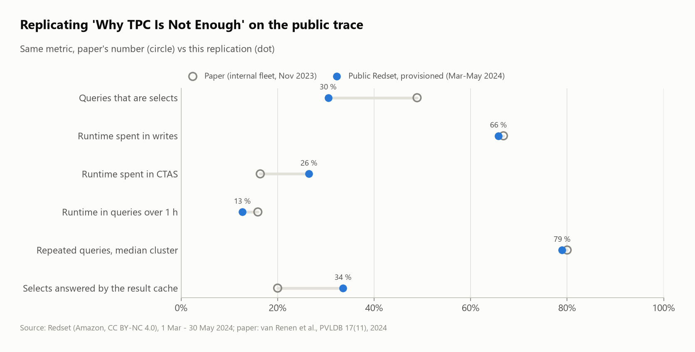
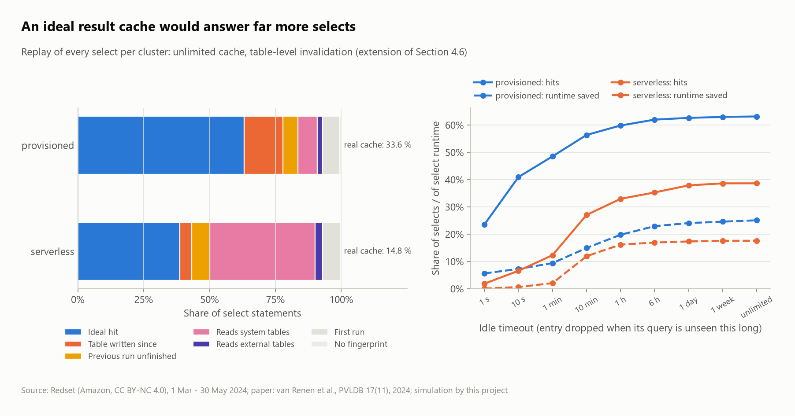

# Is TPC still not enough? Replicating the Amazon Redshift fleet study on the public Redset trace

In *Why TPC Is Not Enough: An Analysis of the Amazon Redshift Fleet* (VLDB 2024), van Renen et al. use internal Redshift telemetry to argue that TPC-H and TPC-DS no longer match what cloud data warehouses run. Amazon published **Redset** alongside the paper: 441 million queries from 200 provisioned and 200 serverless clusters (March–May 2024).

**Question:** do the paper's conclusions hold on the data anyone can download?

This project recomputes the paper's metrics as tested SQL over the **full trace** with DuckDB on one laptop. It compares 29 quantitative claims and adds one analysis the paper does not have: **how much an ideal result cache would save**.

🧠 **How it works and how to defend it:** [LEARN.md](LEARN.md)



## Results in one paragraph

**17 claims are confirmed, 7 partially confirmed and 5 not confirmed** (one more cannot be compared). The core argument holds:
- Writes take two thirds of the runtime: 65.8 % (paper: 66.8 %).
- Runtime tails are even longer: p99.9/median ≈ 7,500×, against 2,030× in the paper.
- 79 % of a month's queries repeat in the median provisioned cluster (paper: 80 %).
- The aggregated fleet is as stable as the paper says: daily spikiness 0.11 vs 0.12.

Several specific numbers do not transfer:
- Only 30.5 % of queries are selects, against 48.9 % in the paper.
- CTAS tables are rarely single-use: 8 % have exactly one reader, against 80 % in the paper.
- Busy clusters read thousands of distinct table sets, not 23.5.

The extension finds that an ideal result cache would answer **63.1 %** of provisioned selects. Redshift's real cache answered **33.6 %**. The ideal cache would save **25.1 %** of select runtime, against 8.3 % today. The model classifies 97.5 % of the real cache hits as hits, which validates it.

## Scorecard

Generated by `src/claims.py` from `results/`. Paper values are from its tables and text (`src/paper.py`).

| § | Claim | Paper | Redset provisioned | Redset serverless | Verdict |
|---|---|---|---|---|---|
| 3.2 | Queries that are selects | 48.9 % | 30.5 % | 30.9 % | not |
| 3.2 | Runtime spent in writes (insert, copy, delete, update, CTAS) | 66.8 % | 65.8 % | 60.8 % | confirmed |
| 3.3 | Runtime spent in CTAS | 16.4 % | 26.5 % | 3.6 % | partial |
| 3.4 | Queries under 100 ms | 62.0 % | 62.4 % | 40.1 % | confirmed |
| 3.4 | Runtime in queries over 1 h | 15.9 % | 12.7 % | 30.8 % | confirmed |
| 4.3 | Runtime tail: p99.9 / median | 2,030x | 7,483x | 7,066x | confirmed |
| 3.4 | Scans per executed query | 2.03 | 1.31 | 0.74 | partial |
| 3.4 | Joins per executed query | 0.53 | 0.52 | 0.56 | confirmed |
| 4.1 | Fleet daily spikiness (March) | 0.12 | 0.11 | 0.15 | confirmed |
| 4.2 | Fleet hourly spikiness (March) | 0.09 | 0.11 | 0.13 | confirmed |
| 4.1 | Clusters at most as spiky as the paper's C2 (daily, 0.28) | 75.0 % | 50.0 % | 12.5 % | partial |
| 4.4 | Repeated queries in the median cluster (month) | 80.0 % | 79.0 % | 54.5 % | confirmed |
| 4.4 | Fingerprints of long queries (10 min-10 h) that repeat, median cluster | - | 82.0 % | 87.3 % | confirmed |
| 4.4 | Same, for queries under 10 ms | - | 32.4 % | 49.7 % | confirmed |
| 4.4 | Median gap between repeats of a select, median cluster | 100 s | 42 s | 35 s | confirmed |
| 4.4 | Median gap between repeats, median repeating query | - | 599 s | 278 s | n/a |
| 4.4 | Longest median repeat gap of a cluster | 12.0 d | 1.0 d | 2.7 d | not |
| 4.6 | Selects that repeat a previous select | 80.0 % | 92.9 % | 92.9 % | confirmed |
| 4.6 | Selects answered by the real result cache | 20.0 % | 33.6 % | 14.8 % | partial |
| 4.6 | Repeating selects that still miss the cache | 60.0 % | 63.9 % | 84.1 % | confirmed |
| 4.6 | ↳ of those misses: reads system tables | 14.0 % | 12.4 % | 51.2 % | partial |
| 4.6 | ↳ of those misses: reads external tables | 4.0 % | 3.3 % | 3.7 % | confirmed |
| 4.6 | ↳ of those misses: a table was written since | 54.0 % | 24.8 % | 5.9 % | partial |
| 3.3 | CTAS statements run once in a week | 66.0 % | 70.8 % | 66.3 % | confirmed |
| 3.3 | CTAS tables read by exactly one query | 80.0 % | 8.1 % | 13.3 % | not |
| 3.3 | Queries reading a CTAS-created table | 40.0 % | 17.6 % | 2.8 % | not |
| 4.5 | Distinct table sets in a busy cluster-month (10 sampled) | 23.5 | 5,884 | - | not |
| 5.2 | Tables with inserts and no deletes the same day | 80.0 % | 76.9 % | 79.1 % | confirmed |
| 5.2 | Tables with deletes and no inserts the same day | 30.0 % | 19.5 % | 1.4 % | partial |
| 3.4 | Runtime spread, p90 / median (TPC-H 22 queries in DuckDB SF 10: 3.6x) | - | 38x | 51x | confirmed |

The paper's Section 5 (data types, skew, storage formats) and its query-text and filter metrics cannot be rebuilt from Redset.

## Three things the data hides

1. **Result-cache hits are logged as `other`.** They have no fingerprint and no tables, only a pointer to the select that produced them. Without restoring them, the cache looks unused (0 % of selects) and a third of all selects go missing.
2. **The trace ends on 30 May.** Including 31 May fakes a drop in load.
3. **Every CTAS gets a fresh table id** (25.36 M creations, 25.34 M ids). "The same table re-created" has to be tracked by the statement's fingerprint instead.

## Extension: an ideal result cache



`sql/50_cache.sql` replays every select of every cluster. A select is an ideal hit when all of these hold:
- the same fingerprint ran before;
- it reads no system or external table;
- the previous run had finished;
- no write to any table it reads committed since the previous run started.

The last write before each query comes from one ASOF join. The idle-timeout curve shows the main finding: **hits are cheap queries repeated quickly, savings are expensive queries repeated slowly**. A 10-minute timeout keeps 89 % of the ideal hits but only about 60 % of the ideal savings.

## Run it

```bash
python -m venv .venv && .venv/Scripts/pip install -r requirements.txt
```
```bash
aws s3 cp --no-sign-request --recursive s3://redshift-downloads/redset/ data/
```
```bash
.venv/Scripts/python src/run.py --sample
```
```bash
.venv/Scripts/python src/run.py
```
```bash
.venv/Scripts/python src/tpc.py && .venv/Scripts/python src/claims.py && .venv/Scripts/python src/figures.py
```
```bash
.venv/Scripts/python -m pytest -q tests
```

The commands, in order:
1. Create the virtual environment and install the dependencies.
2. Download Redset (17.7 GB).
3. Run every analysis on the 1 % samples, to check the code runs (minutes).
4. Run the full trace: a 441 M-row database (~30 GB on disk), about an hour on 16 threads / 32 GB RAM.
5. Run TPC-H/TPC-DS SF 10 in DuckDB, then rebuild the scorecard and the figures.
6. Run the tests on hand-made traces (including the paper's 3/8 repetition example).


| Folder | What's in it |
|---|---|
| `sql/` | `00_prepare.sql` (load + cache-hit restoration), then one file per paper section; each `-- name:` query → `results/<name>.csv` |
| `src/` | `run.py` (runner), `tpc.py`, `claims.py` (scorecard), `figures.py`, `paper.py` (the paper's published numbers) |
| `results/`, `figures/` | every number and chart |

## Credits and license

Paper: A. van Renen, D. Horn, P. Pfeil, K. Vaidya, W. Dong, M. Narayanaswamy, Z. Liu, G. Saxena, A. Kipf, T. Kraska, *Why TPC Is Not Enough: An Analysis of the Amazon Redshift Fleet*, PVLDB 17(11), 2024. Data: [Redset](https://github.com/amazon-science/redset) by Amazon, **CC BY-NC 4.0** (non-commercial use). The data is not redistributed here; `results/` holds aggregates only.
